# Camp Snap 2 filters

Film-style and creative filters for the [Camp Snap 2](https://www.campsnapphoto.com/) (model CS-V201).
Tested on the camera so far: Golden 200, Portrait 400, Superb 400, Velvet 50, Tri-Pan 400, Cinema 800T,
Thermal, Game Boy and Synthwave. The rest use the same format and were checked with a preview model that
matches real photos closely.

## Download

Grab a whole pack from the [latest release](https://github.com/thirdr/campsnap-filters/releases/latest):
`campsnap2-film-filters.zip`, `campsnap2-expired-filters.zip` or `campsnap2-creative-filters.zip`.
Each zip holds that pack's filters and a short INSTALL.txt.

## Installing a filter

The camera has six filter slots. A `.flt` file in the root of the SD card replaces that slot's built-in filter:

| Slot on camera | File name |
|---|---|
| S (standard) | `s.flt` |
| V1 | `v1.flt` |
| V2 | `v2.flt` |
| V3 | `v3.flt` |
| BW | `bw.flt` |
| A (analog) | `a.flt` |

1. Copy the filter you want to the root of the card.
2. Rename it to the slot's file name, e.g. `Golden 200.flt` → `v1.flt`.
3. Put the card back in the camera and select that slot.

Any slot can hold any filter, colour or black and white. Delete a slot's file to get the camera's built-in
filter back. It's handy to keep a `Filters` folder on the card holding the ones you're not using: the
camera ignores `.flt` files in subfolders.

On a Mac, Finder creates hidden `._v1.flt` style files next to anything you copy. Delete them, or the
camera may try to read them as filters (`dot_clean -m /Volumes/<card>` in Terminal does it).

Tip: wait a second after switching filter before taking a photo. The first shot straight after a switch
sometimes comes out with the bottom of the frame in the wrong colours.

## The filters

Every example is the same Camp Snap 2 photo, run through the filter using a model of the camera's
processing measured on a test card. They aren't separate shots, so the filters are easy to compare.

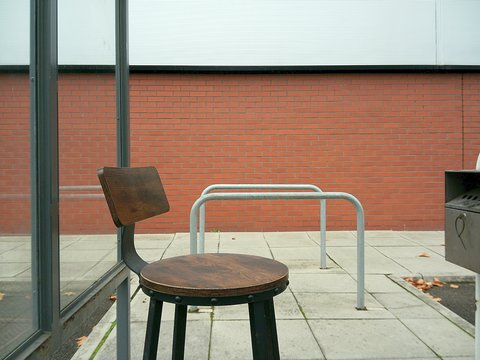 
*No filter*

### Film looks (`filters/film`)

| Filter | Look | Example |
|---|---|---|
| Golden 200 | warm consumer colour negative: rich yellows and oranges, soft highlights | 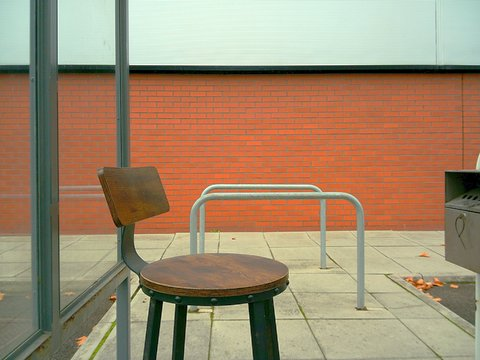 |
| Portrait 400 | soft, pastel portrait negative, kind to skin | 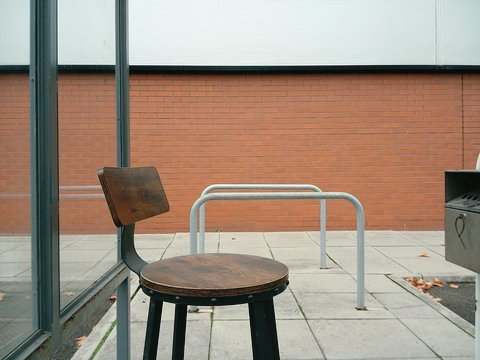 |
| Nectar 100 | vivid, fine-grain colour negative with deep blacks | 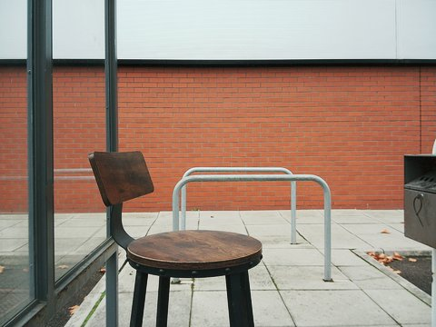 |
| Superb 400 | cool everyday colour negative: punchy greens, teal shadows | 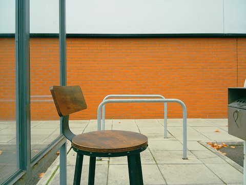 |
| Velvet 50 | vivid slide film: dense blacks, deep greens and blues, rich reds | 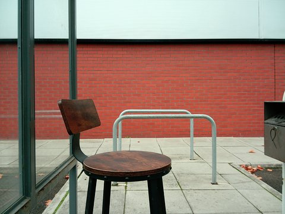 |
| Tri-Pan 400 | contrasty black and white | 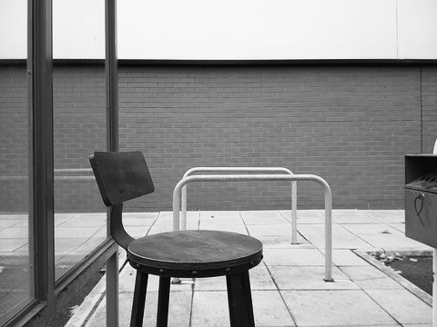 |
| Cinema 800T | tungsten cinema stock: teal tones, glowing reds, deep blacks | 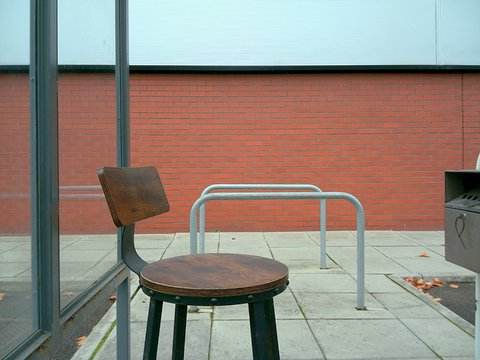 |

### Expired and faded (`filters/expired`)

| Filter | Look | Example |
|---|---|---|
| Magenta Fade | old print whose cyan dye has faded: pink-magenta cast |  |
| Expired Green | green fogged shadows, yellow-green highlights | 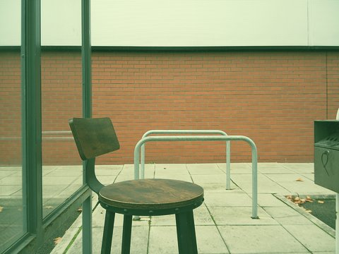 |
| Yellowed Print | 1970s print gone yellow-orange | 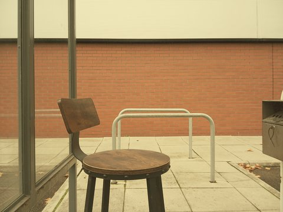 |
| Redscale | film loaded backwards: reds, oranges and yellows | 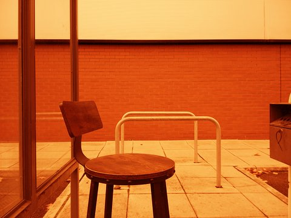 |

### Creative (`filters/creative`)

| Filter | Look | Example |
|---|---|---|
| Cross-process | slide film in negative chemistry: yellow highlights, blue shadows, punchy colour | 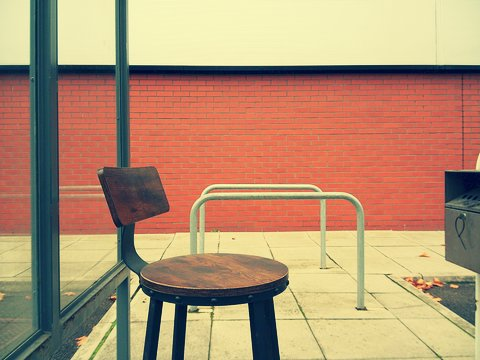 |
| Bleach bypass | desaturated, high contrast, silvery |  |
| Sepia | warm brown-toned black and white | 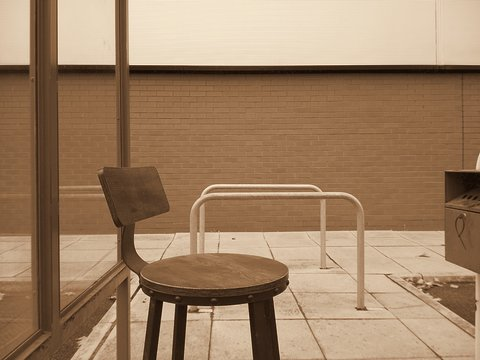 |
| Selenium tone | black and white with cool purple-brown shadows | 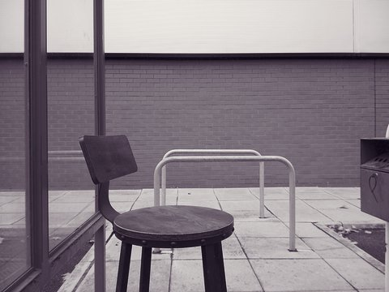 |
| Cyanotype | blueprint-blue monochrome | 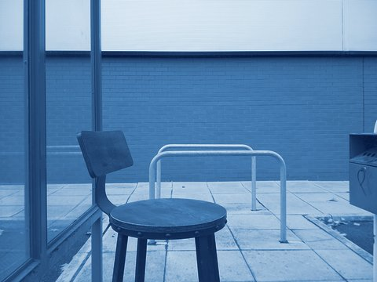 |
| Split tone | warm highlights, cool shadows | 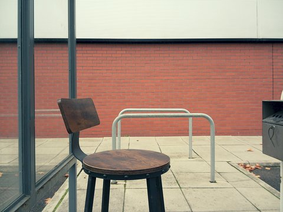 |
| Solarise | tones reverse in the highlights, like darkroom solarisation | 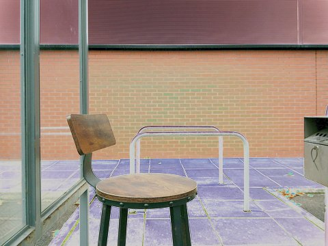 |
| Teal & orange | film-poster grade: teal shadows, warm skin and highlights |  |
| Day for night | daylight shots turned into dark blue moonlight | 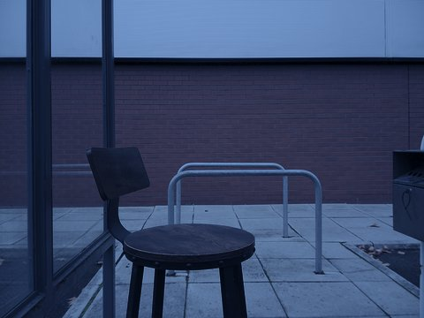 |
| Matte pastel | faded blacks, soft muted colour | 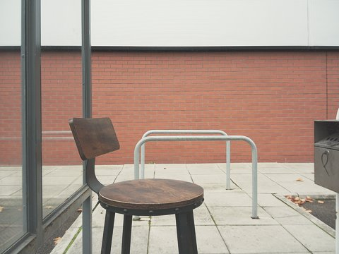 |
| Golden hour | warm late-afternoon sunlight | 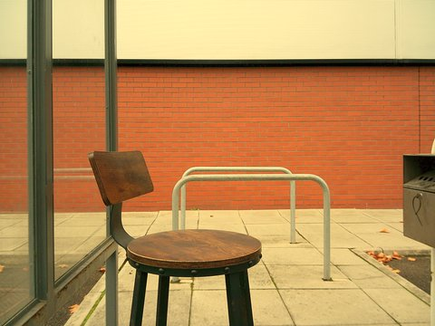 |
| Synthwave | purple shadows, hot pink mids, cyan highlights | 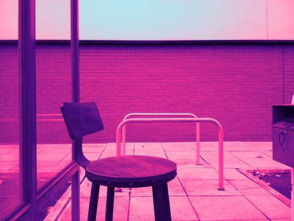 |
| Game Boy | the original handheld's four shades of green | 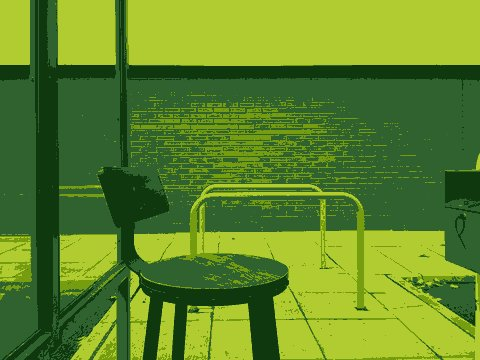 |
| Thermal | heat-camera palette: black, purple, orange, yellow, white | 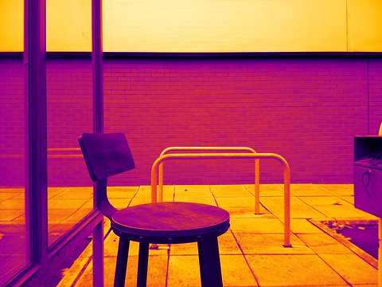 |
| Night vision | green image-intensifier look | 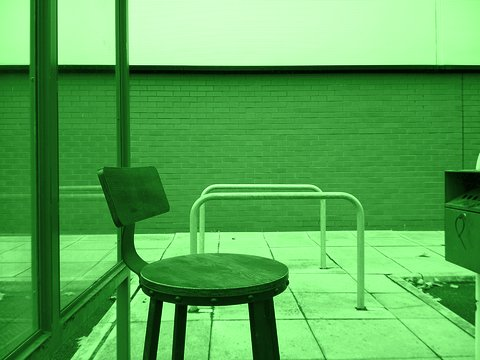 |
| Infrared B&W | glowing foliage, dark skies | 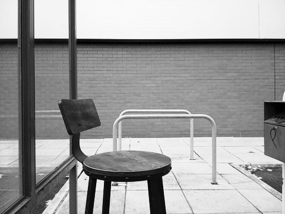 |
| Infrared colour | false-colour infrared: foliage turns gold, reds turn green | 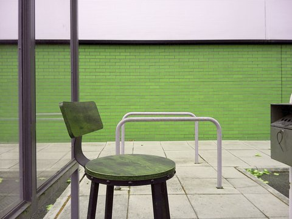 |
| Alien (channel swap) | colours rotated: reds turn blue, greens turn red | 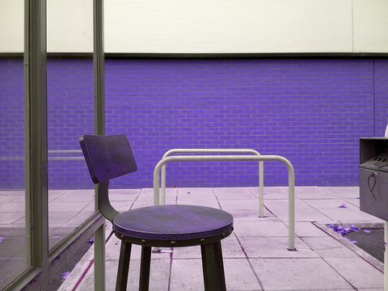 |
| Indoor (tungsten fix) | cools down warm indoor light | 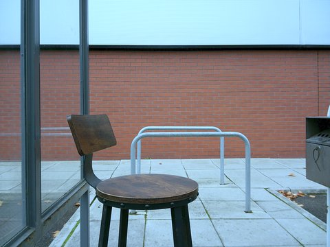 |
| Underwater (red restore) | puts back the reds water absorbs (underwater only, too red on land) | 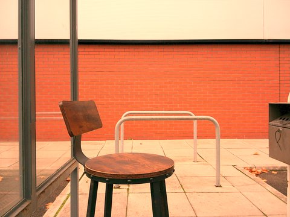 |
| Deuteranopia view | simulates green-weak colour blindness | 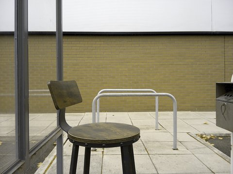 |
| Protanopia view | simulates red-weak colour blindness | 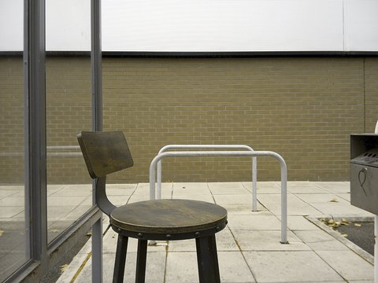 |

The colour blindness views are approximate (matrices from Machado, Oliveira and Fernandes, 2009).

## How the filters work

A `.flt` file is plain text: a line of seven slider values, a 3×3 colour matrix (1024 = 1.0) on the next three
lines, then 256-entry tone curves for red, green and blue. The format matches the "V105" option of Camp Snap's
web filter tool.

Measured on the camera with a test card:

- The camera applies the matrix to the gamma-encoded image, not in linear light. Camp Snap's web
  preview assumes linear light, so it misjudges how saturated a filter will look.
- The curves are applied after the matrix and can go down as well as up, which is what makes the gradient-map
  filters (Thermal, Synthwave, Game Boy, Sepia) work.
- The first line (brightness, contrast, saturation…) is ignored.
- The built-in S filter isn't neutral: it crushes blacks a little.

## Licence

The fitted film looks **Portrait 400, Nectar 100, Superb 400, Velvet 50 and Tri-Pan 400** are adapted from
the RawTherapee Film Simulation Collection ([download](https://rawtherapee.com/shared/HaldCLUT.zip), 420 MB zip)
by Pat David, Pavlov Dmitry and Michael Ezra. The original Hald CLUT tables were fitted to a 3×3 matrix plus
tone curves, then adjusted in tone. These five files are licensed under
[CC BY-SA 4.0](https://creativecommons.org/licenses/by-sa/4.0/): you can share and adapt them if you credit
the authors above and share your versions under the same licence.

Everything else in this repository is under the [MIT licence](LICENSE).

Film names here are deliberately generic. This project isn't affiliated with or endorsed by Camp Snap or any
film manufacturer.
